Last week from the Friday 6th October to Monday 9th, myself, friends and family were celebrating my impending marriage with a stag trip to Riga in Latvia. A great time was had by all, lots of beer was drunk and clubs visited. Below is a little video of where we were on Friday night, excuse the swearing, that would be Gavin 😊 , we spent most of the night at a club called La Rocca and a fun if drunken night was had by all. Surprisingly, we also did a bit of sight seeing while there and took a few photographs.



Feel free to have a look at the photographs below.

## Assorted Photos

### Sight Seeing

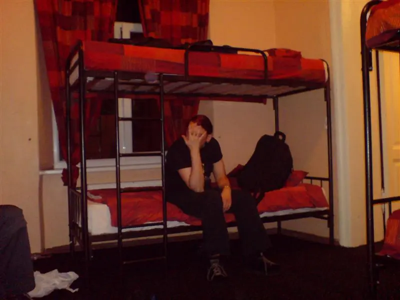
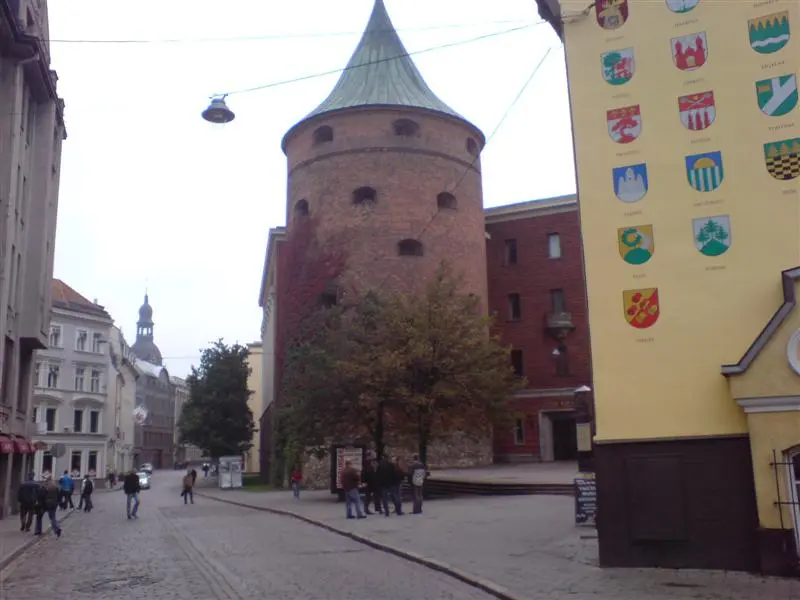
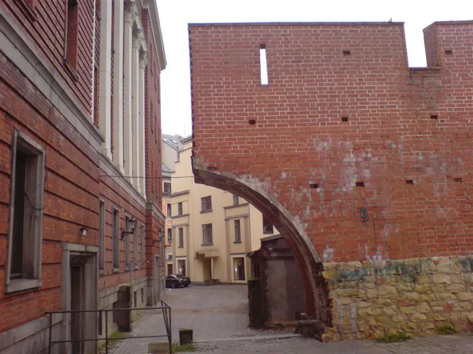
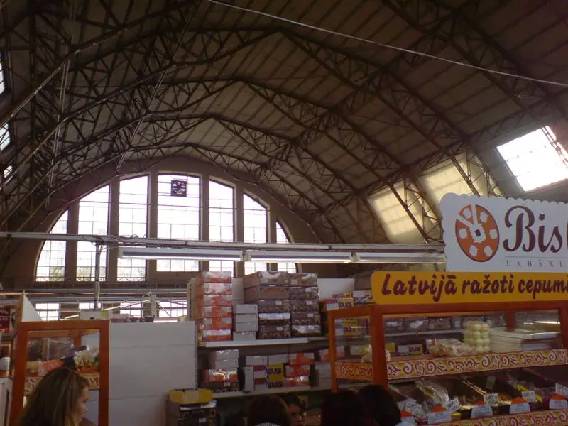
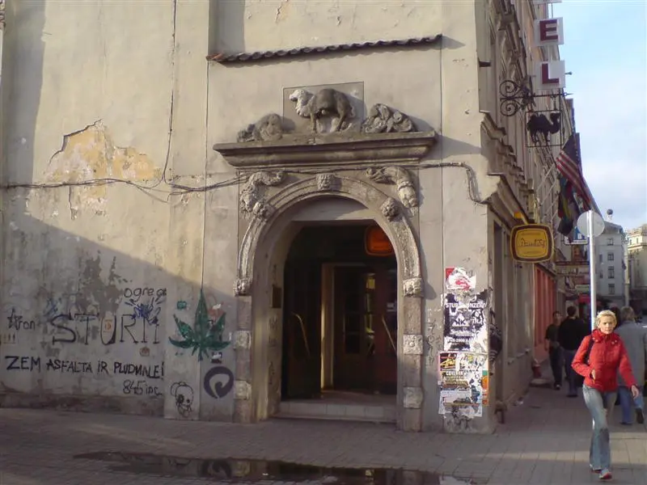
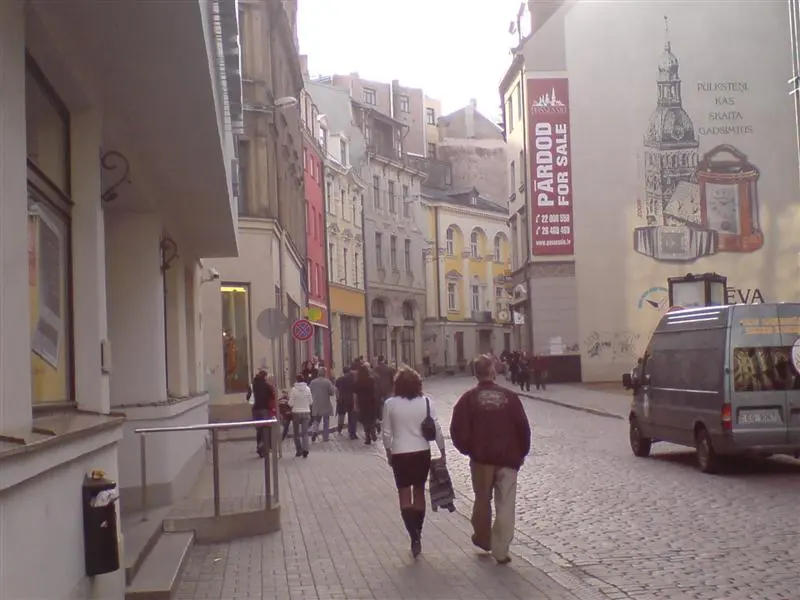
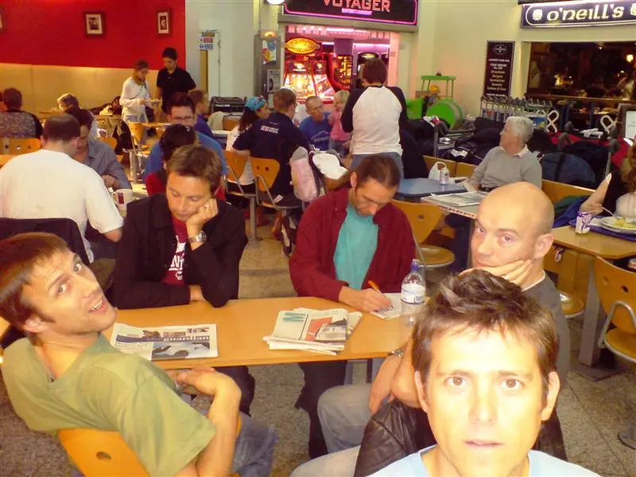
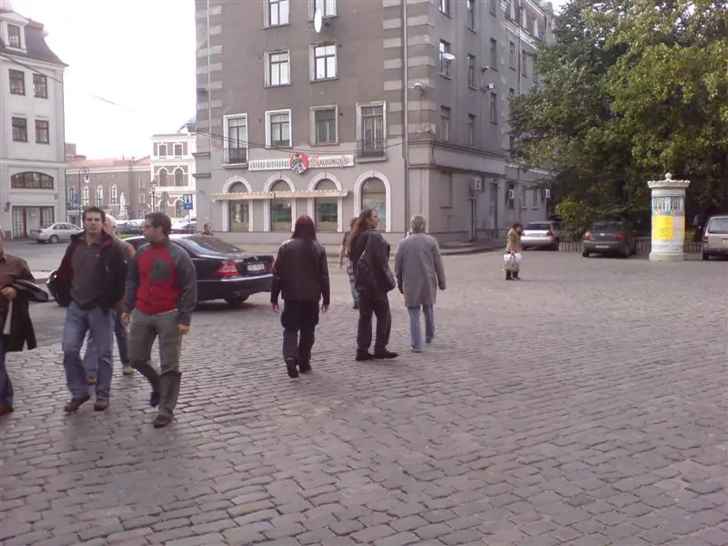
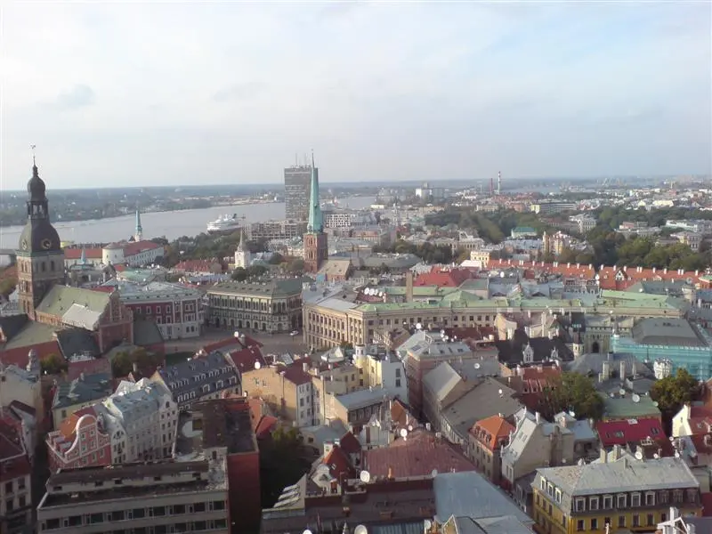
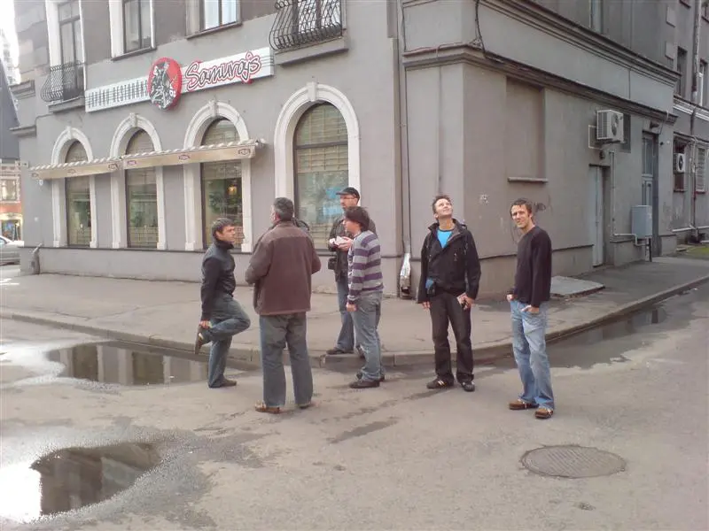
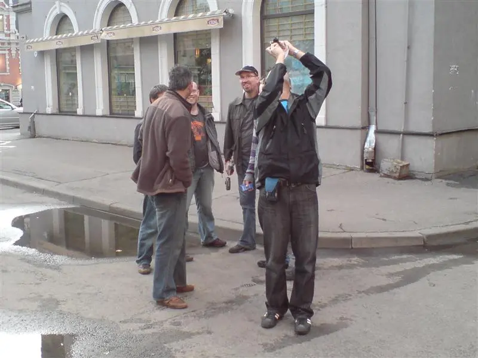
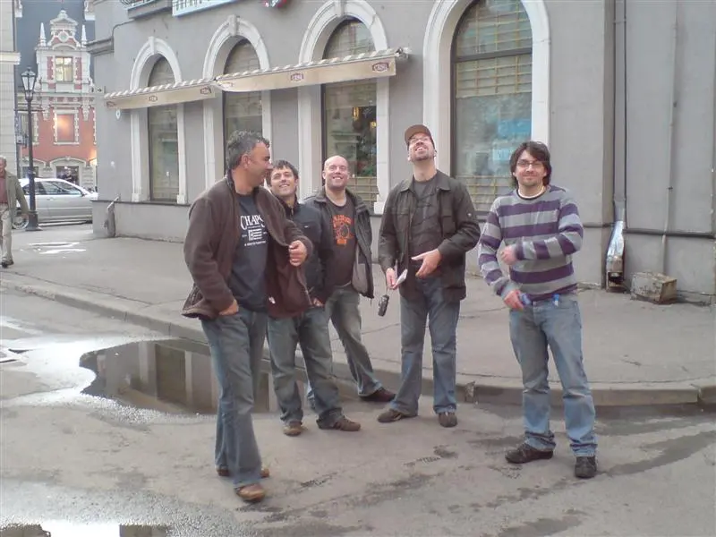
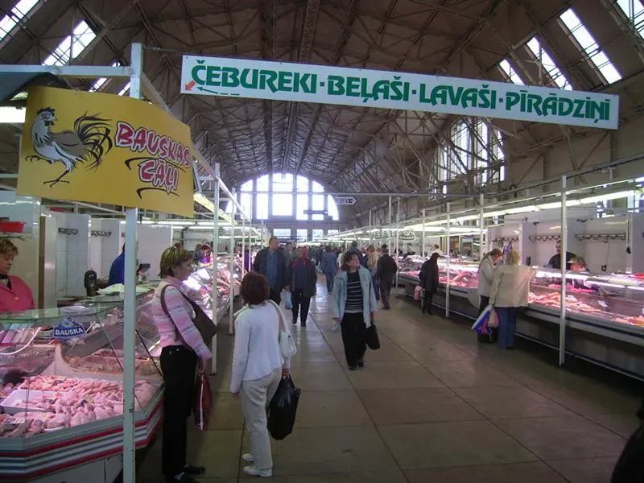
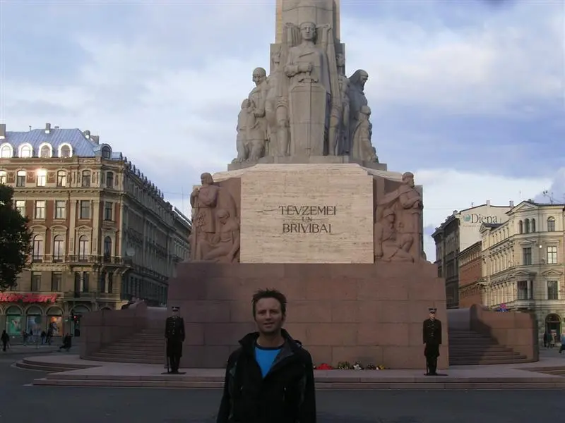
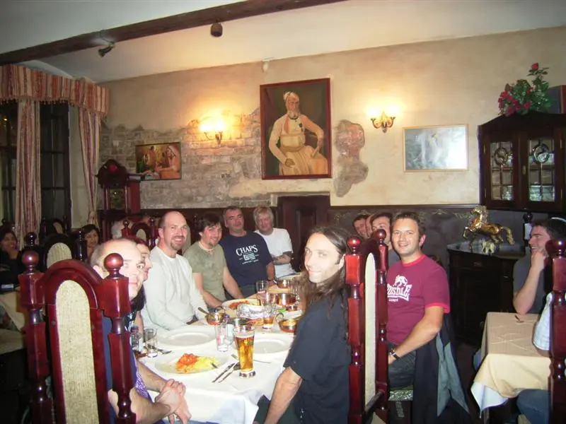
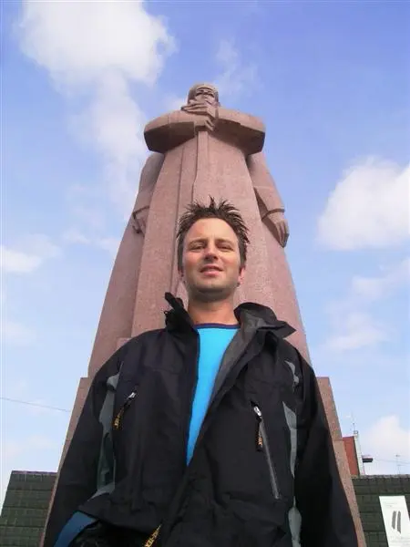

### La Rocca - Riga

- [La Rocca](https://www.google.com/search?kgmid=%2Fg%2F11g69hjv_7)—historically one of Riga's biggest and most famous mega-nightclubs later operating as La Rocca - Revolution and tied to the Royal Casino SPA & Hotel complex on Brīvības iela 96 — underwent major transformations and closures over the years: [1](https://www.tripadvisor.co.uk/Attraction_Review-g274967-d3308736-Reviews-La_Rocca_Night_Club-Riga_Riga_Region.html), [2](https://www.tripadvisor.co.uk/ShowUserReviews-g274967-d3308736-r196846811-La_Rocca_Night_Club-Riga_Riga_Region.html)
- The 2007 Fire: The original venue suffered a major setback when it burned down in December 2007, though it was later rebuilt and reopened. [1](https://www.local-life.com/riga/pubs/46-La_Rocca)
- Evolution and Name Changes: Over subsequent years, parts of the massive entertainment complex evolved, operating alongside or transitioning into spaces like Studio 69. [1](https://www.tripadvisor.com/Attraction_Review-g274967-d3308736-Reviews-or10-La_Rocca_Night_Club-Riga_Riga_Region.html)
- Reunions and Current Use: The space at [Brīvības iela 96A](https://www.google.com/search?kgmid=%2Fg%2F11x19mchh1) has continued hosting nightlife and live events under different names, such as SPELET Concert Hall (ex-La Rocca / ex-Studio 69), which regularly hosts concerts, theme nights, and anniversary throwback parties (such as La Rocca's milestone reunion/birthday events). [1](https://ticketshop.lv/en/events/107923), [2](https://www.instagram.com/p/DaSXlJLNd4i/?__d=1)

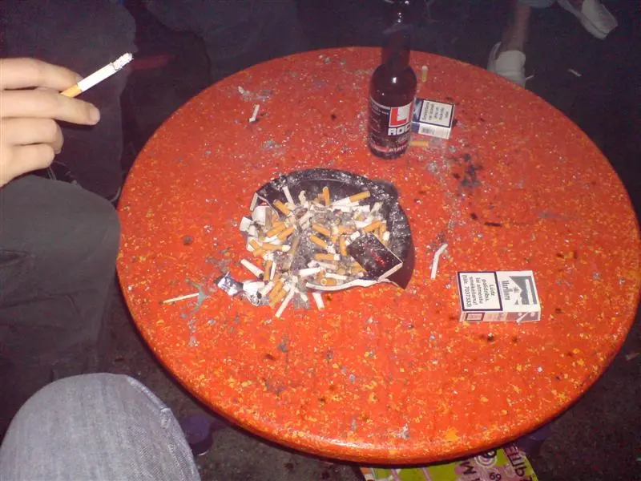
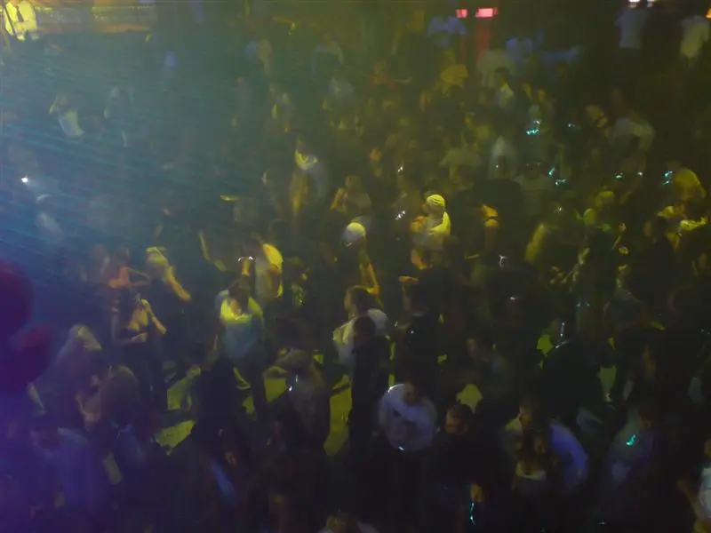

## References

- Riga - [Wikipedia Page](https://en.wikipedia.org/wiki/Riga)
