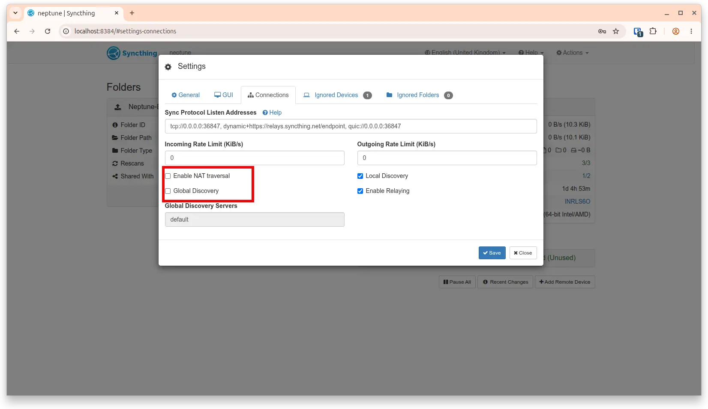
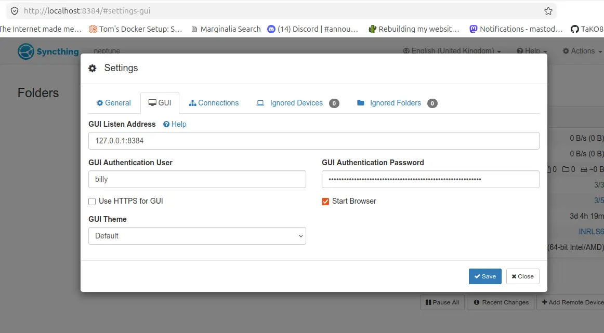
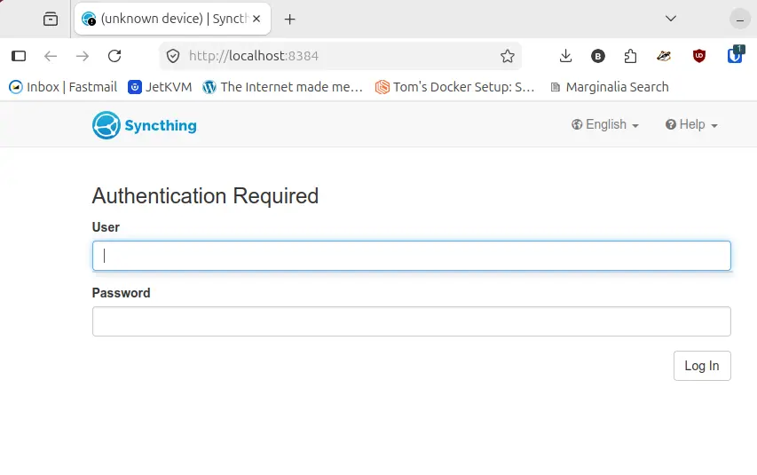

As I do most of my web development on my Linux machine at home, so I thought it prudent to install Syncthing on that machine to backup up my work to my [TrueNAS](https://www.truenas.com/) home server. I'm currently running Ubuntu 24.04.4 LTS, but no doubt these instructions will work on newer Ubuntu distributions going forward.

Syncthing runs per user rather than as a system-wide service. To start it automatically on boot for your user account.

## Install Syncthing

```bash
sudo apt install syncthing
```

## Enable startup after reboot

```bash
# Enable the service for your specific username
systemctl --user enable syncthing.service
systemctl --user start syncthing.service
```

1. Fire up a web browser on the workstation with syncthing installed
2. Bare in mind the address below is localhost.
3. [Local workstation URL](http://localhost:8384)
4. Go to Action -> Settings and add a GUI Authentication User and password
5. As I'm using this locally (on the same subnet), I'm [disabling](https://www.reddit.com/r/Syncthing/comments/14s8yj4/help_understanding_syncthing_global_discovery/?rdt=60534) Nat traversal and Global Discovery This can be found under **Actions** > **Settings** > **Connections**


All going well and assuming you filled in the Username an Password (you may have to clear the cookies for that URL first), you'll be presented with a login box.





## Firewall ports on the host (UFW host firewall)

If your running UFW on Ubuntu, then the following ports will need to be opened.

```bash
sudo ufw allow 22000
sudo ufw allow 21027/udp
```

You can of course firewall it to a specific subnet with something like this.

```bash
sudo ufw allow from 192.168.1.0/24 to any port 22000
sudo ufw allow from 192.168.1.0/24 to any port 21027/udp
```

## References

- Syncthing's great [documention pages](https://docs.syncthing.net/index.html)
- Syncthing [Firewall Settings](https://docs.syncthing.net/users/firewall.html)
- Lawrence Systems great [Syncthing Video](https://www.youtube.com/watch?v=se4V-CgO7ZM&vl=en)
