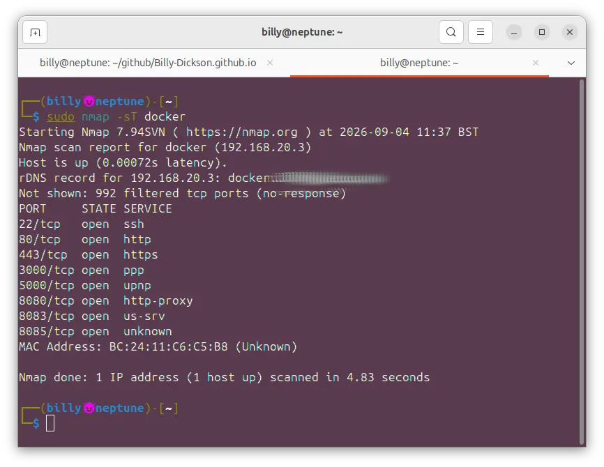

I'm in the process of locking down my docker host (running on Proxmox), good homelab hygiene is probably a good idea in todays fast paced AI driven world.



As I use Ubuntu linux as my docker host in my home lab, and [UFW](https://wiki.ubuntu.com/UFW) firewall, unfortunately, it doesn't work with docker. Thankfully, I found a solution [at this website](https://stackoverflow.com/questions/30383845/what-is-the-best-practice-of-docker-ufw-under-ubuntu)
that should solve my problem.

For anything hosted externally, I'm going to stick with [iptables](https://linux.die.net/man/8/iptables).

I've forked the repository on [github](https://github.com/Billy-Dickson/ufw-docker) just in case it disappears.

## Setup

Before installing ufw-docker it is necessary to check that the Docker iptables feature is enabled. So in case you have disabled it by adding --iptables=false to the /etc/docker/daemon.json, remove that line from the file and restart the docker service.

Ok let’s proceed with the installation:

```bash
sudo wget -O /usr/local/bin/ufw-docker https://github.com/Billy-Dickson/ufw-docker/raw/master/ufw-docker
chmod +x /usr/local/bin/ufw-docker
```

Usage

```text
ufw-docker help
ufw-docker install
ufw-docker status
ufw-docker allow webapp
ufw-docker allow webapp 80
ufw-docker allow webapp 53/udp
ufw-docker list webapp
ufw-docker delete allow webapp 80/tcp
ufw-docker delete allow webapp
```

## References

- Github [Reference](https://github.com/chaifeng/ufw-docker)
- Docker Forum - [Prevent exposing ports](https://forums.docker.com/t/prevent-exposing-ports/134104/14)
- Chaifeng's [github repository](https://github.com/chaifeng/ufw-docker)
