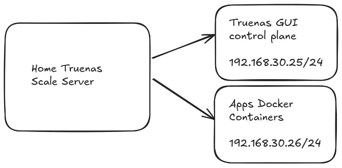
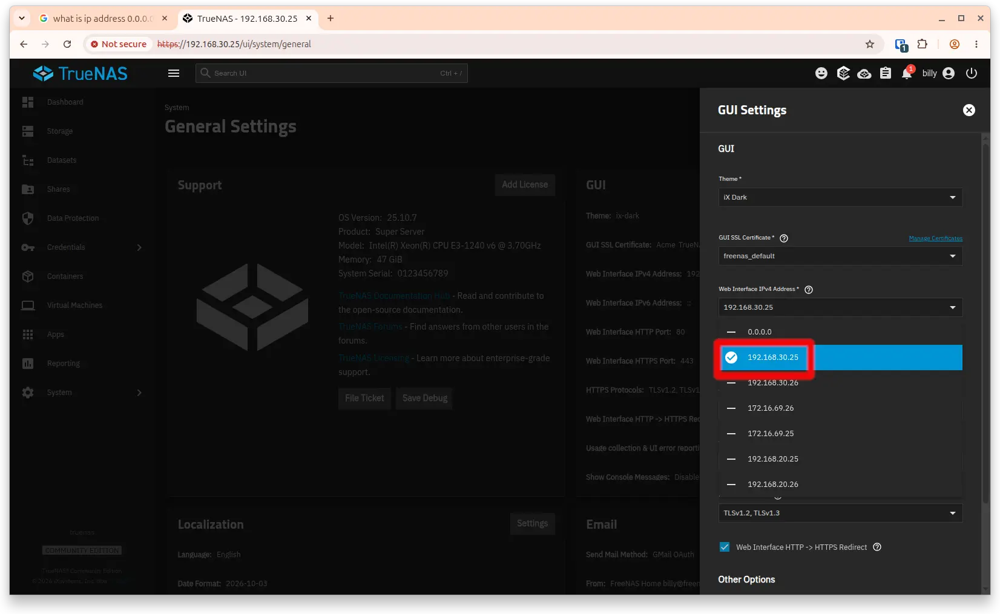
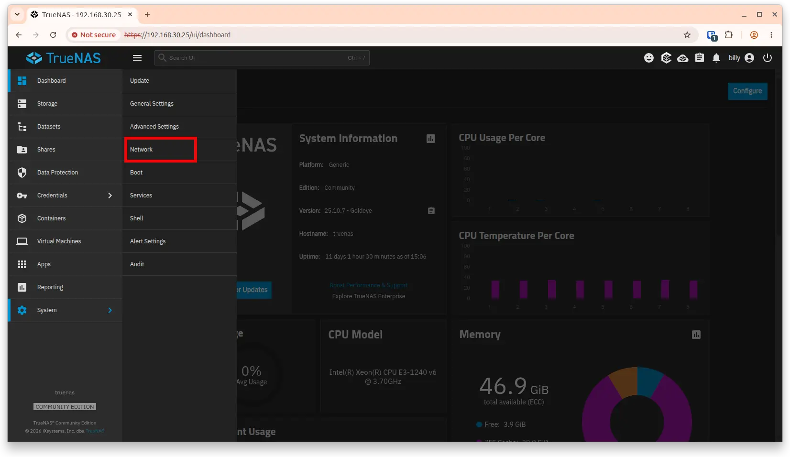
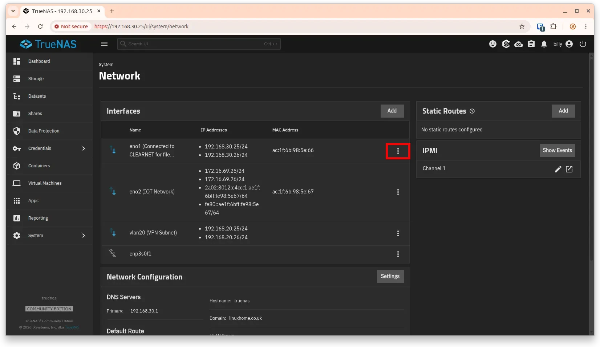
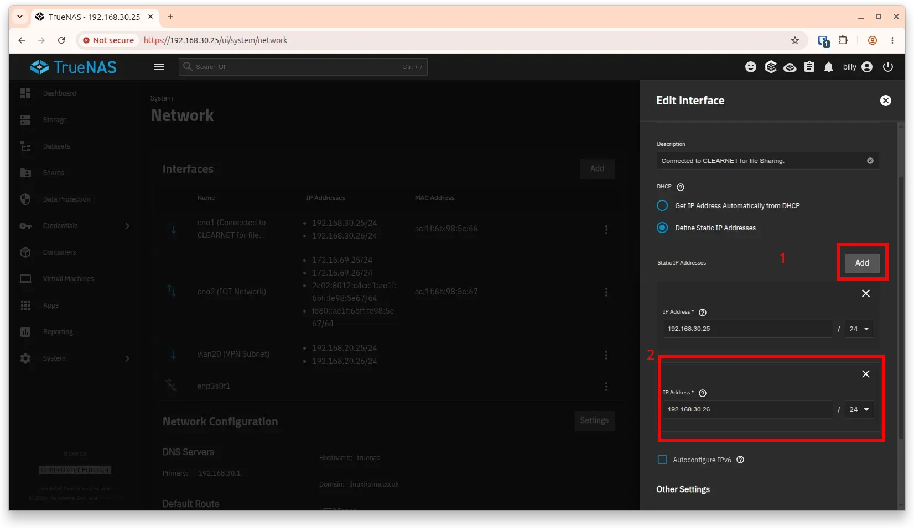
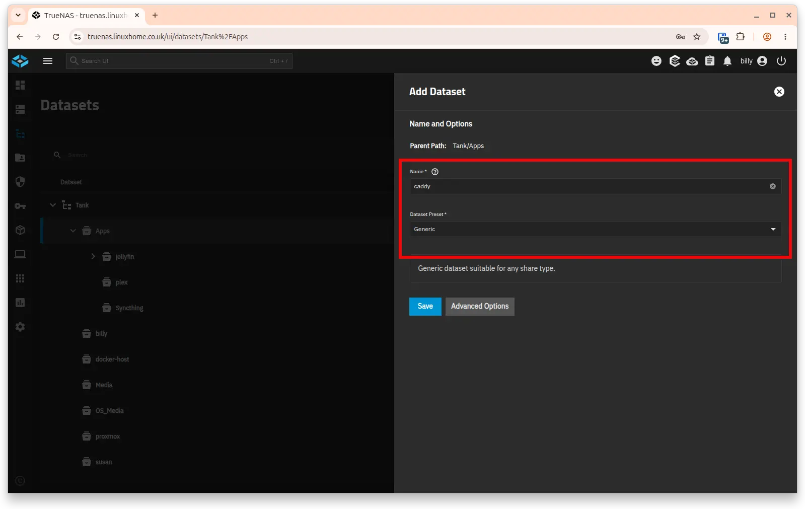
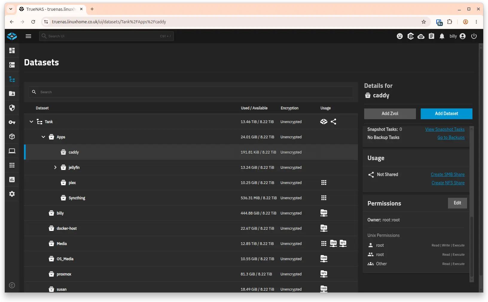
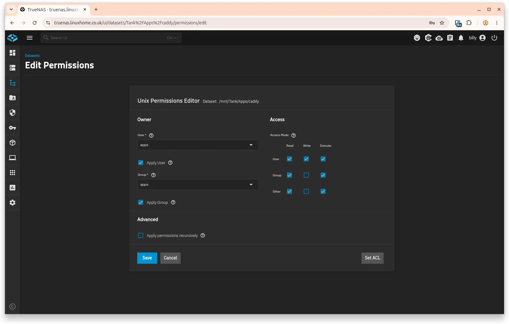

We have a bit of work to do before we install Caddy as an app, see the diagram below that give you a visualisation of what we are trying to do. Do bare in mind that the IP addresses referenced below are what my network uses, yours will mostly likely be different so don't follow the instructions blindly.

## Requirements

- A domain registered with Cloudflare.
- A working knowledge of networking and Linux.
- The ability to change your home networks DHCP and DNS settings.



## Resolve port conflicts and new IP address

### 1. Resolve Port 80/443 Conflicts

By default the TrueNAS web GUI claims ports 80 and 443 on IP address [0.0.0.0](https://superuser.com/questions/949428/whats-the-difference-between-127-0-0-1-and-0-0-0-0). Because Caddy must bind to these ports to enable administration and provisioning, you will have to change the IP address, to the IP address of your TrueNAS Server, then you will need to create another IP address on the same network to be used by Caddy.

1. Navigate to **System Settings** > **General Settings** > **GUI**.
2. Change it from 0.0.0.0 to the IP address of your TrueNAS GUI.


### 2. Create another IP address on your TrueNAS to be used by Apps and Caddy

1. Navigate to **System Settings** > **Network**

2. Click on the **3 vertical dots** and select **Edit**

3. Add the app **IP address**, in my case it's 192.168.30.26 but your's will no doubt be different.


## Create data sets for Caddy

1. Navigate to **Datasets** in the TrueNAS SCALE UI.
2. Create a parent dataset under your storage pool (e.g., `Tank/Apps/caddy`), take the default settings for the moment.

3. Strip default the ACLs and change them to apps

**Strip ACL** and change the **Owner:** and Owner **Group:** to apps, tick **Apply Owner** and **Apply Group**, when prompted tick the **Remove the ACL and permissions from child datasets of current dataset


4. Click on **System** > **Shell** and navigate to your newly created storage pool, then create 2 directories, one called data and one called config, then change the owner to owner and group to apps.

```bash
sudo cd /mnt/Tank/Apps/caddy
sudo mkdir config data
```

```bash
sudo nano Caddyfile
sudo chown -R apps:apps *
```

```text
:80 {  
respond "Hello from TrueNAS 25.10!"  
}
```

## Caddyfile Configuration

Configure your `Caddyfile` to use the Cloudflare DNS challenge globally or per site:

```yaml
{
    # Global option to use Cloudflare for ACME DNS-01 validation
    acme_dns cloudflare {env.CLOUDFLARE_API_TOKEN}
}

example.com {
    reverse_proxy 192.168.1.100:8080
}
```

## Deploy via YAML (Recommended)

This is the fastest and most foolproof method. It bypasses the step-by-step graphical wizard by directly feeding TrueNAS a standard Docker Compose structure.

1. Go to **Apps** in the TrueNAS SCALE sidebar.
2. Click **Discover Apps** in the top right.
3. Click the **three vertical dots (`⋮`)** next to the *Custom App* button, then select **Install via YAML**.
4. Set the **Application Name** to `caddy`.
5. Paste the following configuration in the editor block (make sure to replace `/mnt/your-pool/apps/caddy/` with your exact storage paths):

```yaml
services:
  caddy:
    image: caddybuilds/caddy-cloudflare:latest
    container_name: caddy
    restart: unless-stopped
    user: "568:568"
    cap_add:
      - NET_ADMIN
    ports:
      # Format is Host Port:Container Port
    - "192.168.30.26:80:80/tcp"    # Standard HTTP (TCP)
    - "192.168.30.26:443:443/tcp"  # Standard HTTPS (TCP)
    - "192.168.30.26:443:443/udp"  # HTTP/3 over QUIC (UDP)

    volumes:
      # Update "/mnt/tank/..." to your actual storage path
      # Stores Let’s Encrypt / ZeroSSL certificates
      - /mnt/Tank/Apps/caddy/Caddyfile:/etc/caddy/Caddyfile  
      - /mnt/Tank/Apps/caddy/data:/data
      - /mnt/Tank/Apps/caddy/config:/config
    networks:
      - caddy_net
networks:
  caddy_net:
    driver: bridge
```

## Required Cloudflare Token Permissions

Go to your Cloudflare dashboard and create an API Token with these restricted permissions:

- Zone — DNS — Edit

## References

- Configuring Caddy - [Family Brown Wiki](https://wiki.familybrown.org/en/fester/configure-apps/other/caddy)
- Docker Caddy Cloudflare - [IAreKylew00t](https://github.com/IAreKyleW00t/docker-caddy-cloudflare)
- TrueNAS Documentation - [Using Custom Apps](https://www.truenas.com/docs/scale/24.04/scaletutorials/apps/usingcustomapp/)
- Caddy and Cloudflare - [Docker Instructions](https://caddy.community/t/how-to-guide-caddy-v2-cloudflare-dns-01-via-docker/8007)
