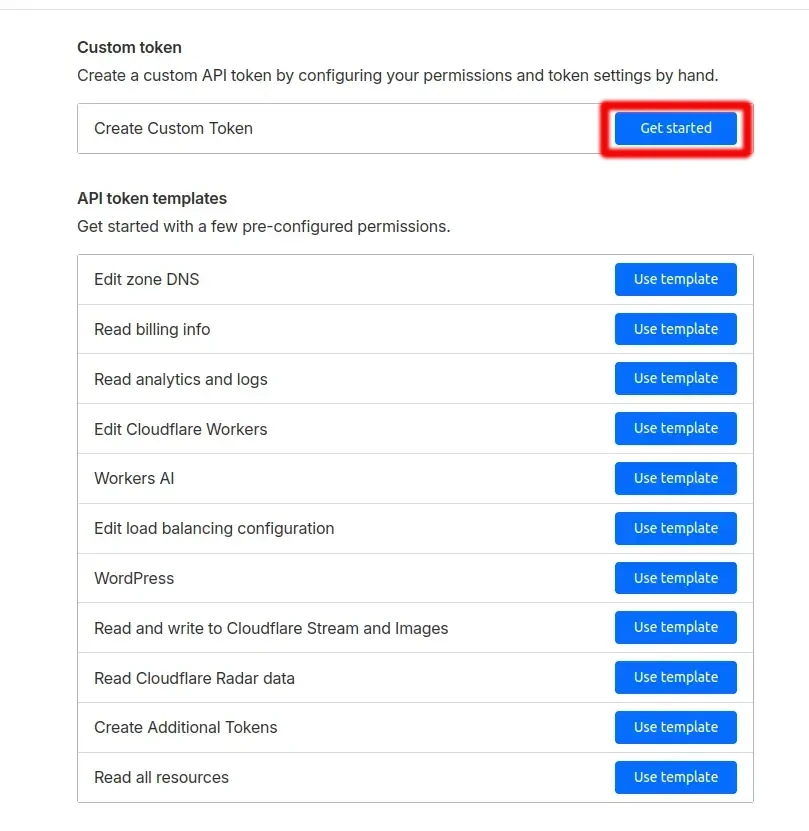
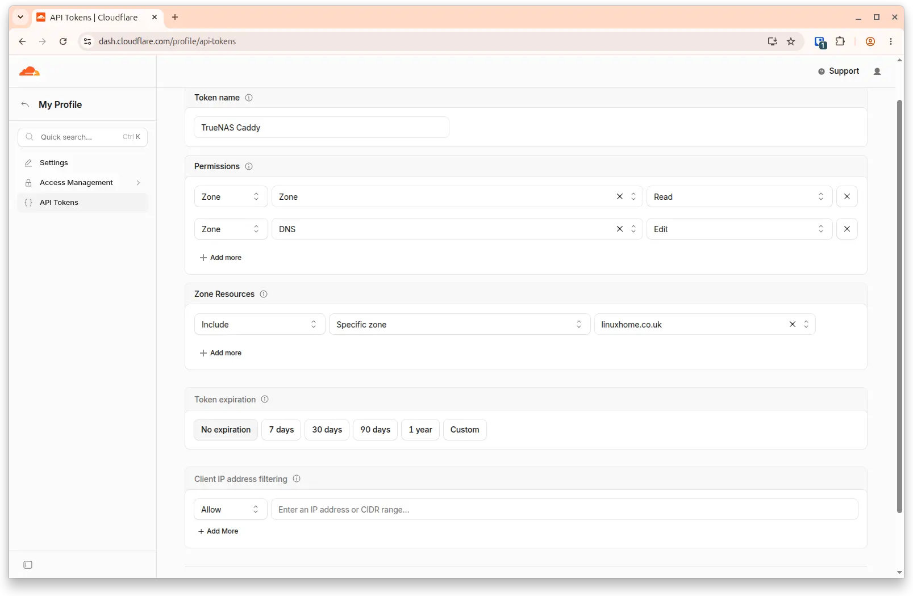
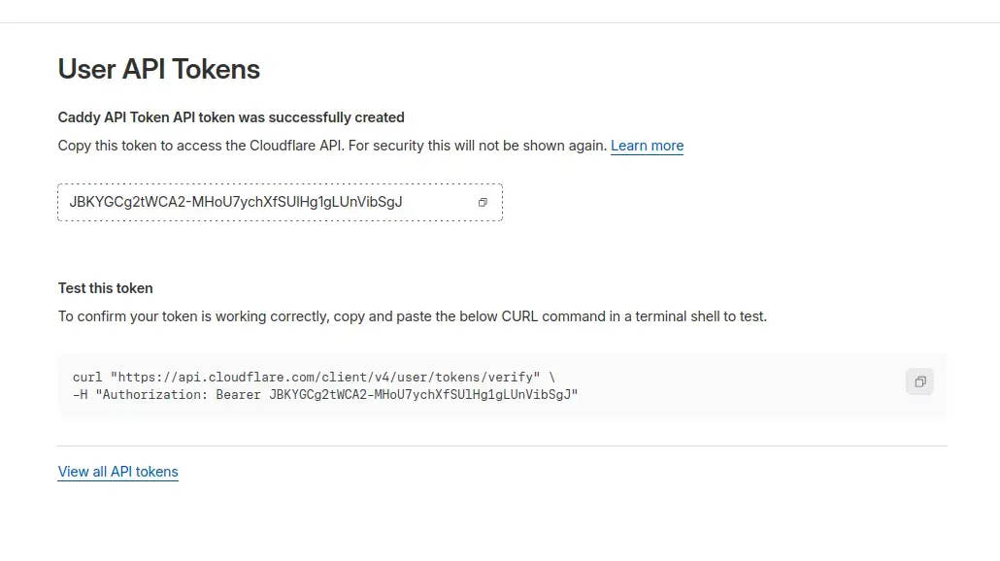
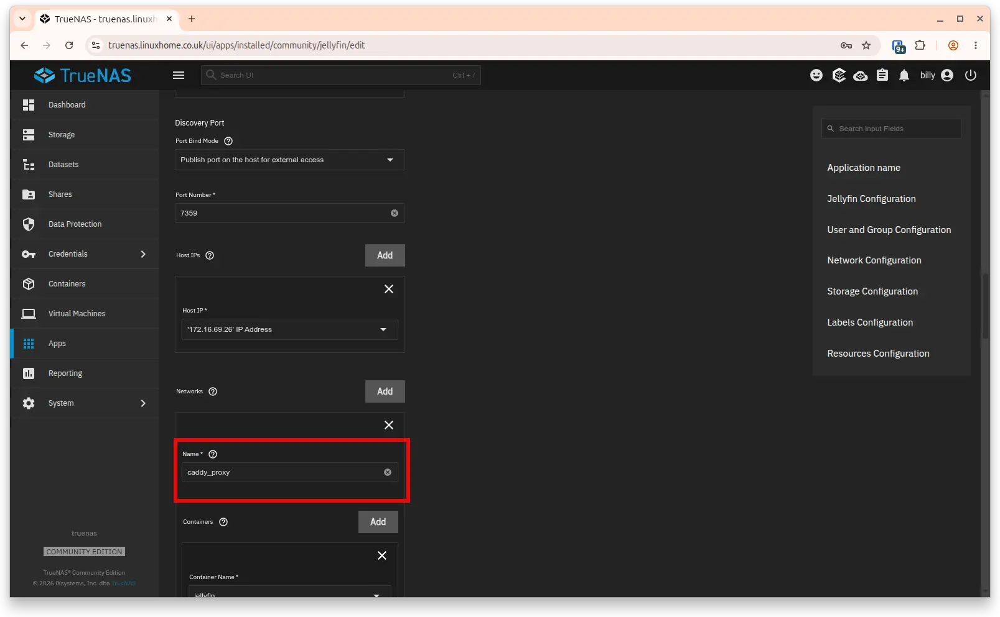
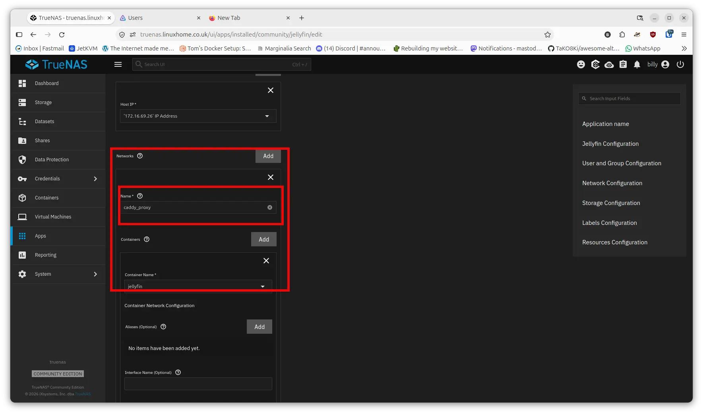
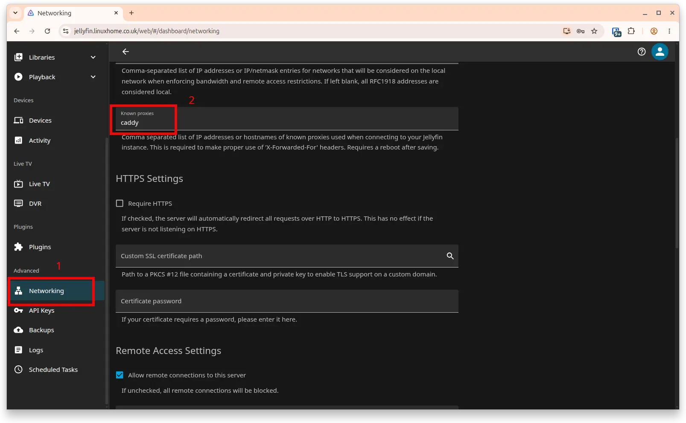
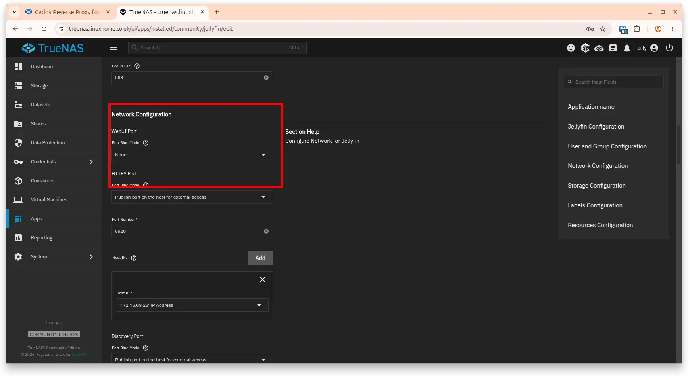

We have a bit of work to do before we install Caddy as an app, see the diagram below that give you a visualisation of what we are trying to do. Do bare in mind that the IP addresses referenced below are what my network uses, yours will mostly likely be different so don't follow the instructions blindly.

## Requirements

- A domain registered with Cloudflare.
- A working knowledge of networking and Linux.
- The ability to change your home networks DHCP and DNS settings.


## Cloudflare API Token

1. Go to [https://dash.cloudflare.com/profile/api-tokens](https://dash.cloudflare.com/profile/api-tokens)
2. Click on your domain (if you have more than one)
3. Click "Get API Token"
4. Click on "Create Custom Token"


5. Set permissions

- Zone:Zone:Read
- Zone:DNS:Edit





__Take a Note__ of the _Cloudflare API Token_ as you will need it later when setting up TrueNAS.

## Resolve port conflicts and new IP address

### 1. Resolve Port 80/443 Conflicts

By default the TrueNAS web GUI claims ports 80 and 443 on IP address [0.0.0.0](https://superuser.com/questions/949428/whats-the-difference-between-127-0-0-1-and-0-0-0-0). Because Caddy must bind to these ports to enable administration and provisioning, you will have to change the IP address, to the IP address of your TrueNAS Server, then you will need to create another IP address on the same network to be used by Caddy.

1. Navigate to __System Settings__ > __General Settings__ > __GUI__.
2. Change it from 0.0.0.0 to the IP address of your TrueNAS GUI.


### 2. Create another IP address on your TrueNAS to be used by Apps and Caddy

1. Navigate to __System Settings__ > __Network__

2. Click on the __3 vertical dots__ and select __Edit__

3. Add the app __IP address__, in my case it's 192.168.30.26 but your's will no doubt be different.


## Create data sets for Caddy

1. Navigate to __Datasets__ in the TrueNAS SCALE UI.
2. Create a parent dataset under your storage pool (e.g., `Tank/Apps/caddy`), take the default settings for the moment.

3. Strip default the ACLs and change them to apps

__Strip ACL__ and change the __Owner:__ and Owner __Group:__ to apps, tick __Apply Owner__ and __Apply Group__, when prompted tick the **Remove the ACL and permissions from child datasets of current dataset


4. Click on __System__ > __Shell__ and navigate to your newly created storage pool, then create 2 directories, one called data and one called config, then change the owner to owner and group to apps.

```bash
cd /mnt/Tank/Apps/caddy
sudo mkdir config data logs
```

## Caddyfile Configuration

Create a Caddyfile and past in the text below, do remember to change the domain name to one the that you have registered with Cloudflare (replace both example.com entries). The Caddyfile below uses wild card domain setup rather than per domain (*.example.com), I've put a jellyfin example in that works, as long as you change the domain to your own Cloudflare domain.

If you've already installed Jellyfin, then you'll have to change the default container network to _caddy_proxy_



```bash
sudo nano Caddyfile
```

```text
{
  # Global Options
  # ACME DNS configuration using Cloudflare

  acme_dns cloudflare {env.CLOUDFLARE_API_TOKEN}
  email {env.CLOUDFLARE_EMAIL}
}

# Snippet for internal-only access
(internal_only) {
  @not_internal not remote_ip 192.168.0.0/16 10.0.0.0/8 172.16.0.0/12
  respond @not_internal "Access Denied" 403 {
    close
  }
}

# Snippet for common settings
(common) {
  encode zstd gzip

  header {
    # Security headers enable HSTS
    Strict-Transport-Security "max-age=31536000; includeSubDomains; preload"

    # Prevent MIME type sniffing
    X-Content-Type-Options "nosniff"

    # Prevent clickjacking
    X-Frame-Options "DENY"
    Referrer-Policy "strict-origin-when-cross-origin"

    # Control how much referrer info is sent
    Referrer-Policy "camera=(), microphone=(), geolocation=()"

    # Strong Content Security Policy (Adjust based on your app needs)
    # Content-Security-Policy "default-src 'self'; script-src 'self'; object-src 'none'; base-uri 'self';"

    # Remove backend server signatures to hide stack details
    -Server
    -X-Powered-By
  }
}

# Site block for root and all subdomains
linuxhome.co.uk, *.example.com {
  import common

  # Required for Wildcard certs via Cloudflare DNS
  tls {
    dns cloudflare {env.CLOUDFLARE_API_TOKEN}
  }

  # Logging - helps with debugging
  log {
    output file /var/log/caddy/access.log {
      roll_size 10mb
      roll_keep 5
    }
  }

  # Jellyfin
  @jellyfin host jellyfin.example.com
  handle @jellyfin {
    # I'm only using the reverse proxy internally to reduce the threat surface.
    import internal_only

    # FIXED: Added explicit header pass-throughs for WebSockets 
    # and streaming buffers required by Jellyfin.
    reverse_proxy jellyfin:8096 {
      header_up X-Real-IP {remote_host}
      header_up Upgrade {http.request.header.Upgrade}
      header_up Connection {http.request.header.Connection}

      # Prevents Caddy from buffering video streams, which causes timeouts
      flush_interval -1
    }
  }

  # Default fallback
  handle {
    respond "404 - Service not found" 404
  }
}
```

Change the owner and group of everything in that directory to apps.

```bash
sudo chown -R apps:apps *
```

## Deploy via YAML (Recommended)

This is the fastest and most foolproof method. It bypasses the step-by-step graphical wizard by directly feeding TrueNAS a standard Docker Compose structure. Remember to change CLOUDFLARE_API_TOKEN and CLOUDFLARE_EMAIL for your own.

1. Go to __Apps__ in the TrueNAS SCALE sidebar.
2. Click __Discover Apps__ in the top right.
3. Click the __three vertical dots (`⋮`)__ next to the _Custom App_ button, then select __Install via YAML__.
4. Set the __Application Name__ to `caddy`.
5. Paste the following configuration in the editor block (make sure to replace `/mnt/your-pool/apps/caddy/` with your exact storage paths):

```yaml
services:
  caddy:
    image: caddybuilds/caddy-cloudflare:latest
    container_name: caddy
    environment:
      - CLOUDFLARE_API_TOKEN=cfut_blahhdeblahh
      - CLOUDFLARE_EMAIL=billy@example.com
    restart: unless-stopped
    user: "568:568"
    cap_add:
      - NET_ADMIN
    ports:
      # Format is Host Port:Container Port
    - "192.168.30.26:80:80/tcp"    # Standard HTTP (TCP)
    - "192.168.30.26:443:443/tcp"  # Standard HTTPS (TCP)
    - "192.168.30.26:443:443/udp"  # HTTP/3 over QUIC (UDP)

    volumes:
      # Update "/mnt/tank/..." to your actual storage path
      # Stores Let’s Encrypt / ZeroSSL certificates
      
      - /mnt/Tank/Apps/caddy/Caddyfile:/etc/caddy/Caddyfile  
      - /mnt/Tank/Apps/caddy/data:/data
      - /mnt/Tank/Apps/caddy/config:/config
      
      # Access log files
      - /mnt/Tank/Apps/caddy/logs:/var/log/caddy
    networks:
      - caddy_proxy

networks:
  caddy_proxy:
    name: caddy_proxy
    driver: bridge
```

## Jellyfin Setup and Caddy (Optional)

Requirements.

1. A working Jellyfin installation on TrueNAS Core.
2. Linux knowledge and a bit of Docker knowledge.

Change the Docker network for your jellyfin installation to caddy_proxy.



Log into Jellyfin as an admin, select Network and in proxy field, type caddy.



Log into TrueNAS, Select Apps > jellyfin > Edit and change WebUI Port to none, no point if running a reverse proxy and still having port 8096 open.



## References

- Configuring Caddy - [Family Brown Wiki](https://wiki.familybrown.org/en/fester/configure-apps/other/caddy)
- Docker Caddy Cloudflare - [IAreKylew00t](https://github.com/IAreKyleW00t/docker-caddy-cloudflare)
- TrueNAS Documentation - [Using Custom Apps](https://www.truenas.com/docs/scale/24.04/scaletutorials/apps/usingcustomapp/)
- Caddy and Cloudflare - [Docker Instructions](https://caddy.community/t/how-to-guide-caddy-v2-cloudflare-dns-01-via-docker/8007)
