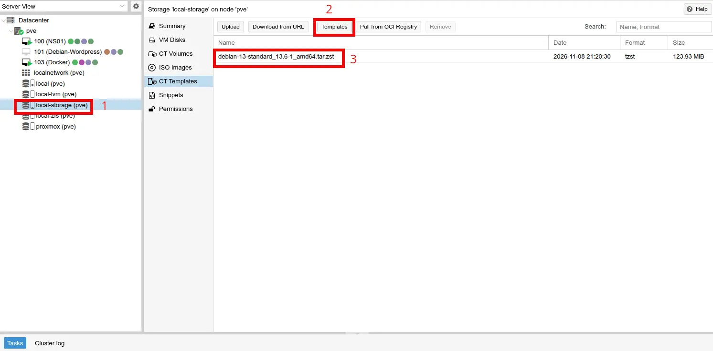
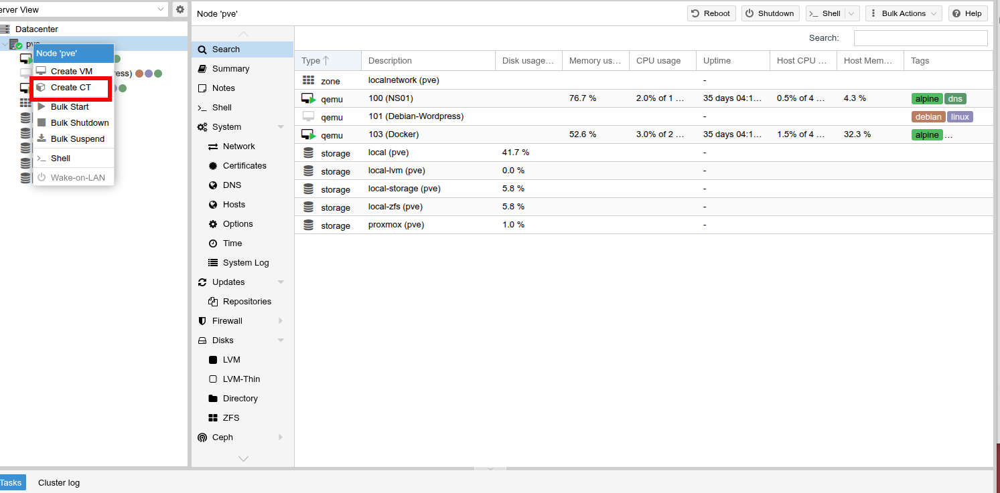

### Download a Template
 Navigate in the Proxmox Web GUI to your storage (e.g., `local`), select **CT Templates**, and click **Templates** to download a Linux distribution template (like Debian or Ubuntu), I'm picking Debian 13.


### Launch the Wizard 

Right-click the Proxmox node and click **Create CT** (Create Container).

  - **Configure Settings:**
  - **General:** Set the Container ID, hostname, and root password.
  - **Template:** Choose your downloaded OS template or OCI image.
  - **Disks:** Specify root disk storage and size.
  - **CPU/Memory:** Assign CPU cores and RAM/Swap limits.
  - **Network:** Choose a network bridge (e.g., `vmbr0`)
  - **Finalize and Start**

### Create an admin user and add packages

From the proxmox terminal login as root update and install sudo

```bash
apt update && apt upgrade
apt install sudo
```

Create a user and add them to the sudo group

```bash
adduser billy

# replace <username> in my case the user I created above.
adduser <username> sudo
```

Log out as root and test your new user by installing git and pull down some packages.

```bash
sudo apt install git
git clone https://github.com/billy-dickson/dotfiles
cd dotfiles
sudo ./install.sh
```

If you've installed zsh, then type zsh to get the the prompt.