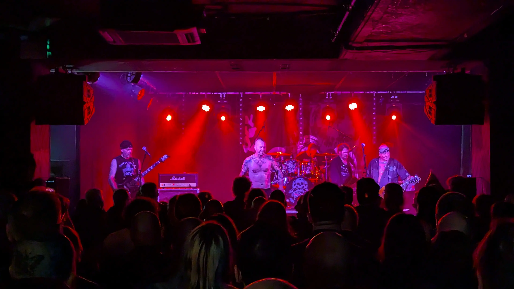

The last time I seen Discharge play, was at [Henry's Cellar Bar](https://henryscellarbar.co.uk/2022/07/24/the-future-of-henrys-as-a-venueor-lack-thereof/) on the 28th September 2018, with my mates [Rus](https://www.facebook.com/russel.redpath), [Gavin](https://www.facebook.com/gavin.archibald.12), [Mark](https://www.facebook.com/mark.dawson.545) and [Chris](https://www.facebook.com/profile.php?id=100009257857124), them having to move the gig from 8th April 2018, after some shenanigans with by the Barra’s venue allegedly.

I don't think I've ever been that close to a live band, If you happened to have been there, you'll know what I'm taking about. Thankfully someone who was there, posted a video of the night so feel free to have a look yourself.

Tonight, the band were pretty damn good, although in my humble opinion, the better gig was at Henry's in 2018 as it was more up close and personal (more punk? Is that's a thing?).



## The Venue

Venue - [La Belle Angel](https://la-belleangele.com/)

## The Bands

### Subvision UK

Unfortunately we missed these guys, deciding to have another beer at [Bannermans](https://www.bannermanslive.co.uk/) and a catchup with friends, no doubt I'll see these guys at some point [Subvision UK](https://www.facebook.com/subvision.ok.1)

### Face UP

We did manage to see [Face UP](https://www.facebook.com/faceup.uk) who sounded pretty good.

### Discharge

As you would expect, Discharge, the main band of the night were exellent as always.

_Discharge_

_Discharge_

_Discharge_

### Henry's Cellar Bar? What happened?

Henry's Cellar Bar in Edinburgh was most recently managed and owned in its final years by Claire Grandemange (who took over around 2016 to save the venue after it changed hands multiple times), with earlier iterations managed/run by figures like DJ Kulu in the mid-to-late 1990s when it operated as a jazz club

- Here's a statement from their website, I'm putting it here, because as we all know, websites disappear all the time on the internet, and it's good to have a record somewhere. There's old website is [link here](https://henryscellarbar.co.uk/)
- Here's an old Gofundme page for the [staff and the venue](https://www.gofundme.com/f/henrys).
- Recent Ownership: Claire Grandemange ran the venue for its final years up until its permanent closure in 2022 following a legal dispute. It operated under the company/name associated with Good Kunst Ltd / management team.
- Earlier History: In the mid-to-late 1990s (when it was known as Henry's Jazz Cellar Bar), it was run by DJ Kulu.

#### Posted July 24th 2022

> I realise it’s been a very long time since we last posted, but there was not much we could publicly share… although as of this week there are obvious changes people have started to notice, and it looks like what used to be Henry’s will reopen soon as a completely different thing, and some folks have been talking and sharing their concerns online, so I guess it’s time to try to explain a little bit.
>
> In 2020 we found ourselves in the middle of a very convoluted situation that threatened our future, and although we’d been hoping to come back one day somehow, in the last few days it’s been made a lot clearer to everyone that it isn’t gonna be the case – not any time soon anyway, or at least not in the same location!
>
> And I’m not blaming Covid, if anything Covid helped us keep the faith a little while longer, the timing was “perfect” for us, if you can call that perfect; all venues had to shut down anyway, so it wasn’t just us, and there was help, and we could use that time to sort out issues and get ready to reopen.
>
> In the end we had to give up just a few months ago, we can’t discuss all the ins and outs here, and unfortunately there’s nothing anyone can do at this point to help, we had all the help we could get including funding, support from the Music Venue Trust, and a couple of good solicitors on our side, but it was a really complicated legal situation involving 5 different parties over the course of 2 years (special thanks to Nicolas McBride from BTO Solicitors who was the one representing us), which may still end up in court one day – or not.
>
> In March we ended up having to clear the venue completely, and although we’d tried to keep staff on as long as there was still some sort of hope, we had to make everyone redundant, with the last employee finishing last month (whilst we were still sorting stuff out that’s now in storage – we’re probably gonna have to try and sell most of it soon too).
>
> The spirit of Henry’s (and the spirit of Good Cunts) may come back in another form or location one day (we own the trademark after all, for real, so at least no chancers can try and cash in on the name), but in the meantime that’s what’s about to replace us: karaoke apparently. And bland colours. I’d expect a lot of slickness too, the exact opposite of what Henry’s has always stood for. What a sad statement.
>
> I’d like to thank everyone for their support over the 17 years I’ve been involved with Henry’s (especially the last few since 2016 when I finally got to run the whole venue including the bar myself), and everyone who supported Henry’s even before then, since its beginnings as a music venue 30 years ago, but that’s us for now.
>
>And since I own the rights to the name Henry’s Cellar Bar I’m also hoping to use the website to start some sort of archive / story of the crazy Henry’s years we’ve had, whenever I can get my shit together whilst in the middle of trying to sort other stuff and looking for work!
>
> Anyway, to quote a heartfelt post from our journalist friend and long-time supporter Neil Cooper from earlier today:”Henry’s was a very special kind of mess.”
>
> Thanks everyone, and watch this space if you want to hear more…
>
> Claire

## References

- Discharge - [Website](https://thenightmarecontinues.yolasite.com/tour-dates.php)
- Discharge - [Wikipedia Page](https://en.wikipedia.org/wiki/Discharge_(band))
- Henry's Cellar Bar - [Website](https://henryscellarbar.co.uk/)
- The Barra's - [Wikipedia](https://en.wikipedia.org/wiki/The_Barras)
- Discharge - A [Negative Insight Story](https://www.negativeinsight.com/niblog/discharge-the-untold-story-behind-their-iconic-minimalistic-aesthetic)
